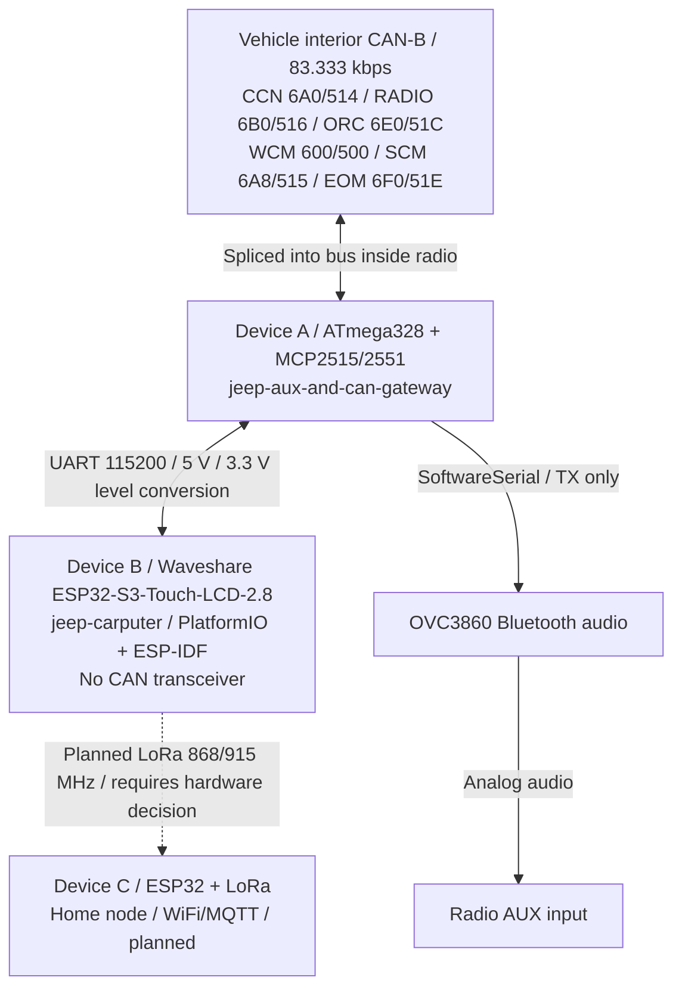
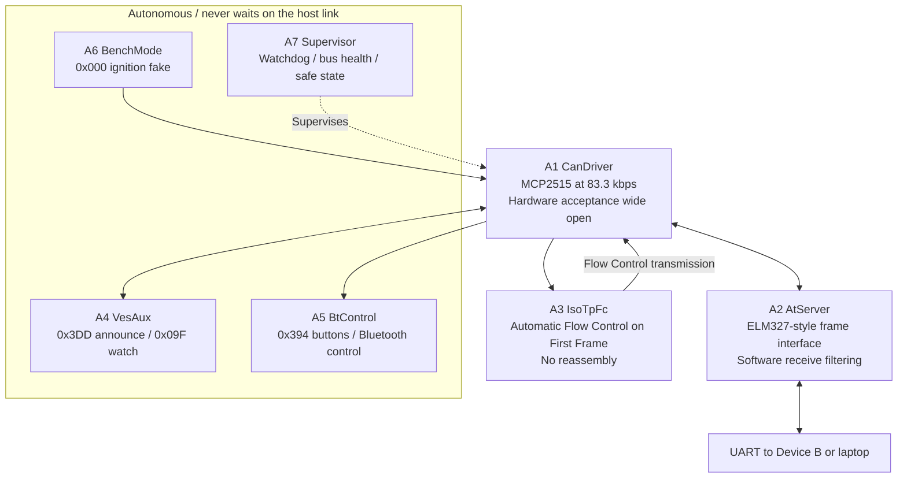
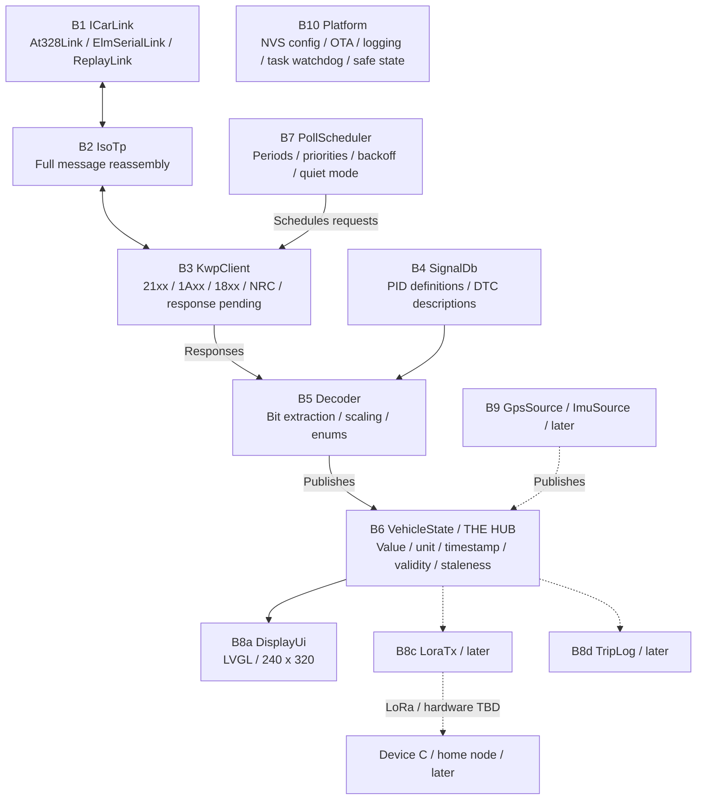
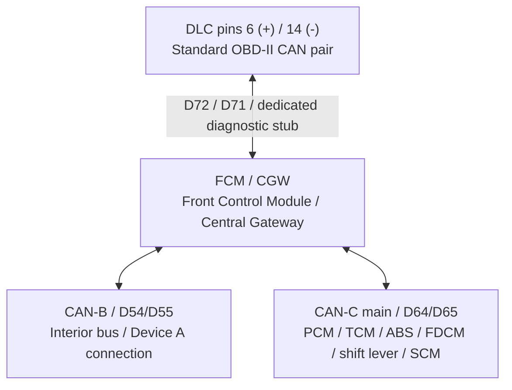

# Jeep in-car computer — system architecture

How the pieces fit together, across the whole project rather than one board. Written to
survive between sessions: the per-project detail lives in each folder's own README.

* **Vehicle:** 2005 Jeep Grand Cherokee WH, interior **CAN-B bus at 83.333 kbps**.
  (Newer models run the interior bus at 125 kbps and call it "high-speed" — none of the
  ids here transfer.)
* **Guiding constraint:** the ESP32 has **no CAN transceiver**. The ten-year-old ATmega328
  board in the radio is the only path to the vehicle.

---

## The system

### Hardware and links

The CAN-B peers above reflect the recorded probe results. The FCM/CGW diagnostic
interface is on the DLC stub; see the [gateway topology](#gateway-topology) below.
Dashed links are planned. LoRa does not fit the current board's available GPIOs;
see the hardware reality check below.

### Device A: autonomous functions and frame link

The AT interface carries diagnostic frames but cannot control the autonomous
radio/AUX/Bluetooth functions. `AT@BENCH` is the documented bench-only exception.

### Device B: protocols, state and presenters

Presenters read only `B6 VehicleState`. `B10 Platform` provides cross-cutting
services to Device B. Dashed paths represent later features.

No web UI: **LVGL only**, by decision. The first Device B milestone is a
deliberately throwaway screen that proves the data path — a couple of live values and a DTC
count. The real interface gets planned as its own exercise; do not let the test UI accrete into it.

## Hardware reality check on Device B

Established from the Waveshare schematic, not assumed:

* **No CAN transceiver on the board**, confirming the premise this whole architecture rests on. The
  S3 has a TWAI controller but no internal transceiver, so CAN-C would need an external one.
* **Only four usable GPIOs**, all on JST-SH 1.0 mm connectors rather than 0.1" headers, so the
  supplied cables are mandatory: **IO43/IO44** (UART0) and **IO15/IO18** (J8 spares, also wired to
  SD_D1/SD_D2 with 10k pull-ups). Everything else is committed to the LCD, touch, octal PSRAM
  (IO33-37), flash, TF card, I2S audio, IMU/RTC I2C, battery sense and USB.
* UART0 is genuinely free: there is no USB-serial bridge chip, USB-C goes straight to GPIO19/20, so
  the console is native USB-Serial-JTAG and printf debugging coexists with the link.
* Caveat on that: the **ROM bootloader prints its boot log on U0TXD (IO43) at every reset**
  regardless of console config, so the 328 sees noise whenever the ESP32 restarts. Harmless -- the
  328 answers `?` to anything unparseable -- but the link handshake drains before starting.
* PSRAM is **octal**, and the S3 Kconfig defaults to quad at 40 MHz. Wrong mode means the board does
  not boot. `sdkconfig.defaults` sets `SPIRAM_MODE_OCT` + `SPIRAM_SPEED_80M`. Not 120 MHz: that is
  gated behind experimental flags and warns of PSRAM corruption after a ~20 C temperature swing,
  which is precisely what a car interior does.
* Touch controller depends on board revision -- **V1 = CST328, V2 = CST3530** (shipping since
  2026-06-05). Different registry components with different APIs. The label on the back decides.

### LoRa does not fit, and that reshapes the roadmap

The link takes IO43/44 and a GPS UART takes IO15/18. That is every free pin. LoRa needs five or six
(SCK/MOSI/MISO/CS/RST/BUSY) and the only way to find them is to share the LCD's SPI3 bus or the TF
card's pins -- neither of which is broken out, so it means soldering to the LCD flex or the card
socket.

So the 2.8 is a display board, not the car unit. The cleaner split is to keep it as the LVGL/UI
development board -- it is genuinely good at that, with 8 MB octal PSRAM and a clean SPI panel -- and
put the I/O-heavy role on something with pins. A board carrying an **onboard CAN transceiver** would
also collapse the biggest open question in this document: the ESP32 could sit directly on CAN-C, which
makes the `7E0` gateway-forwarding test irrelevant and puts all 1152 DTCs plus live engine data in
reach without depending on the cluster's mirrored values at all. That is a decision to take
deliberately, not by drift.

### Toolchain

PlatformIO + `framework = espidf` is verified working: an `esp32s3` image builds under WSL with
framework-espidf 5.3.2. The known friction is ahead of us rather than behind -- PlatformIO handles
`idf_component.yml` managed dependencies poorly, and the LVGL work needs exactly those
(`esp_lvgl_port`, `lvgl`, the Waveshare touch driver). Nothing so far pulls a registry component. When
that changes, either vendor them into `components/` or move to native `idf.py` + CMake.

---

## Why it is split this way

Three invariants carry the whole design. Everything else is negotiable.

**1. The car never depends on the host.** `A4`/`A5`/`A6` are driven only by what they see on
the bus. They never wait on the UART, and the AT surface has no command that can reach
them — no way to change the radio source, stop the VES announce, or power the Bluetooth
module. Unplug Device B, or plug in a laptop running something broken, and the car behaves
exactly as it did in 2015. `AT@BENCH` is the single exception and is meaningless in a car.

This is also why Device A applies the host's `ATCRA`/`ATCF` filter **in software** and
leaves the MCP2515's hardware acceptance wide open: a hardware filter set for a diagnostic
session would stop `0x09F` and `0x394` reaching the controller at all, freezing the
Bluetooth power pin and killing the seek buttons for the duration — which is the normal
running state once Device B is polling. Same reason `ATZ` does not re-initialise the CAN
controller: a host resetting in a loop would stall the VES announce and the head unit
would drop AUX.

**2. The link carries frames, not meanings.** There is no `GET_TPMS`. Device A is a dumb
frame pipe, so its firmware is written once and never changes as Device B grows features.
All the interpretation — ISO-TP reassembly, KWP parsing, PID decoding, scaling — lives on
the ESP32 where there is RAM, flash and a debugger. The one exception is `A3 IsoTpFc`,
because the *adapter* must auto-send the Flow Control frame or every multi-frame reply
(i.e. every DTC list) stalls forever.

**3. `B6 VehicleState` is the only thing presenters can see.** A new screen, or a LoRa
packet, never touches protocol code. Sources publish, presenters subscribe.

---

## Blocks

### Device A — ATmega328 (built, never run on hardware)

| Block | Responsibility |
|---|---|
| `A1 CanDriver` | MCP2515 @ 83.3 kbps / 16 MHz behind `ICanBus`; bounded init, bus-off recovery, saturating counters |
| `A2 AtServer` | ELM327-style line protocol; software-side frame matching; `AT@` extensions; implements `IEventSink` |
| `A3 IsoTpFc` | Frame classification + the auto Flow Control frame. No reassembly |
| `A4 VesAux` | `0x3DD` announce every 500 ms; `0x09F` low nibble `== 6` → AUX → BT power pin |
| `A5 BtControl` | `0x394` byte 3 → OVC3860 `AT#MD`/`AT#ME`/`AT#MA`, debounced; one-slot deferred send while the link is busy |
| `A6 BenchMode` | `0x000` ignition fake, EEPROM-persisted runtime toggle |
| `A7 Supervisor` | Watchdog, RX-silence detection, re-init, safe state, uptime and free RAM |

### Device B — ESP32-S3 (not started)

| Block | Responsibility |
|---|---|
| `B1 ICarLink` | Send/receive frames over the UART link; `ReplayLink` for desk development against recorded traffic |
| `B2 IsoTp` | Single/First/Consecutive handling and reassembly into complete PDUs |
| `B3 KwpClient` | Request builders, `+0x40` positive-response rule, negative codes, `7F xx 78` pending |
| `B4 SignalDb` | PID definitions and DTC descriptions. **Storage still undecided:** generated flash table vs a file on LittleFS |
| `B5 Decoder` | Bit extraction and scaling. Conventions: **big-endian bytes, LSB-first bits, offset counted from byte 0 of the full response** |
| `B6 VehicleState` | Fixed-size signal slots; the hub |
| `B7 PollScheduler` | What to poll how often, priorities, backoff, suspend when the ignition is off |
| `B8a DisplayUi` | LVGL screens |
| `B10 Platform` | Config, OTA, logging, watchdog, safe state |

Protocol logic (`B2`, `B3`, `B4`, `B5`) must be written with **zero ESP-IDF dependencies**
— no `esp_log`, no `esp_err_t` in signatures — so it compiles in a host build and can be
unit-tested. IDF-dependent code stays in `B1`, `B7`, `B8` and `B10`.

---

## What the cluster and gateway will give us

The finding the project rests on: `CCN` and `FCMCGW` are both CAN-B peers, and both mirror
CAN-C-sourced values in their own PIDs — necessarily, since the cluster has to receive RPM
and coolant temperature in order to display them. So **the whole dashboard is reachable
from the interior bus with no transceiver.**

| Domain | `CCN` 6A0/514 | `FCMCGW` 620/504 |
|---|---|---|
| Engine | `213E` RPM, speed, distance per wheel; `2140` coolant temp, throttle | `21B1` RPM, PRND; `21B0` speed |
| Trip | `2103` fuel level %; `213E` distance L/R | `21A3` **odometer**; `210C` tire circumference, axle ratio |
| Faults | `213F` MIL, oil, ABS, ESP, charging, water-in-fuel, wait-to-start lamps | `2140` lamp/relay states |
| Environment | `2134` ambient temp, system voltage; `2152` compass | `2110` ambient, battery V + temp; `2111` A/C pressure |
| Fluids | `2135` washer/coolant/brake low flags | `2112` washer level; `2113` brake + coolant level |
| TPMS | `2130` pressure indication, TPM localisation, chime | `210B` TPMS + TPMS Premium config bits |
| Body | `2110` doors/liftgate ajar, parking brake, seat belt; `2149` ParkSense | `2120` hood ajar, brake switch, reverse; `2101` wheel speed |
| Identity | `1A88`/`1A90` VIN | `1A88`/`1A90` VIN |

Two caveats that shape the UI:

* `CCN 213F` reports that the **MIL is lit**, not which P-code lit it. Per-code engine faults
  live in `PCM` on CAN-C.
* **No per-wheel psi PID exists** for this vehicle. `CCN 2130` gives warn state and which
  corner. Real pressures would need the TPMS Premium variant (`FCMCGW 210B` bit 98), which
  needs a live config read to confirm.

DTC coverage on the interior bus, no gateway hop needed — all use `18 00 FF 00`:

| Reachable now | codes | | Needs CAN-C | codes |
|---|---:|---|---|---:|
| ORC airbag | 185 | | PCM engine | 226 |
| FCMCGW gateway | 176 | | TCM transmission | 84 |
| WCM immobiliser | 93 | | ABS | 82 |
| CCN cluster | 88 | | FDCM AWD | 76 |
| SCM steering column | 53 | | ESM shifter | 8 |
| RADIO | 51 | | | |
| EOM overhead | 30 | | | |
| **676 (59%)** | | | **476 (41%)** | |

> **Measured results are in
> [jeep-aux-and-can-gateway/docs/CAN-B-CAPABILITIES.md](jeep-aux-and-can-gateway/docs/CAN-B-CAPABILITIES.md)**
> — what CAN-B actually gives us, what is missing, and what the gaps cost.
> Raw evidence in [PROBE-LOG.md](jeep-aux-and-can-gateway/docs/PROBE-LOG.md).

### ANSWERED 2026-09-11: CAN-C is not reachable from CAN-B, and the fix is a connector

Tested in the car with the ignition on **and** with the engine running. All five CAN-C
modules were addressed from the interior bus and none answered: PCM `7E0`, TCM `7E1`,
ABS `784`, FDCM `7B6`, ESM `788`. An exhaustive sweep of every request id `600`..`6FF`,
with the receive filter opened across the whole `500`..`5FF` response range, found
**exactly six responders** -- CCN, RADIO, ORC, WCM, SCM, EOM -- and nothing else.

The factory schematics (`temp/Jeep WK Schematics.pdf`, Fig. 8/9) explain why:

#### Gateway topology

The gateway translates selected signals between the buses. Diagnostic requests
from the CAN-B side were not forwarded to CAN-C in the recorded tests.

`D71`/`D72` touch exactly two things in the entire vehicle: the Data Link Connector and
the FCM. The gateway routes between **that stub** and the two buses -- which is what a
scan tool plugs into -- and it translates selected *signals* B<->C (how the cluster gets
RPM to display) but does not route diagnostic *requests* arriving from the CAN-B side.
Our board is spliced onto CAN-B, behind the gateway, so a `7E0` request lands on a bus
where no PCM exists.

This also corrects the earlier note above about "no SGW hop": there **is** a gateway, it
is the Front Control Module, and the reason it never answered at `620/504` is that its
diagnostic interface is on the stub rather than on CAN-B.

**Consequence, and it is a cheap one.** The dashboard is built on CCN mirrors today, and
CAN-C is one connector away rather than a harness splice: **tap DLC pins 6 and 14**, the
standard OBD-II CAN pair, so an OBD-II pigtail plugs straight in under the dash. Behind
it is the gateway and through it the whole CAN-C side -- PCM 226 PIDs, TCM 84, ABS 82,
FDCM 76, ESM 8, and 476 DTCs. Cost is one ~$2 transceiver at 500 kbps.

The ESP32-S3's native TWAI controller is left deliberately unused, so that
transceiver can put Device B straight onto CAN-C later with no architectural change.

---

## Status

| | State |
|---|---|
| Device A firmware | **Built, compiles, 38 host tests pass — never run on hardware** |
| Device A bench regression | Not done. The gate: radio still offers VES and BT power still follows AUX, with the UART both connected and unplugged |
| In-car probe session | Not done. Worksheet at `jeep-aux-and-can-gateway/docs/PROBE-LOG.md`; its results are the input to Device B |
| Device B | Not started |
| Device C, LoRa, GPS | Not started |

Open decisions: `B4` storage (generated flash table vs LittleFS file), and confirming free
GPIO on the ESP32-S3-Touch-LCD-2.8 against its schematic — LoRa and GPS will need SPI plus
a UART, and sharing the TF card's SPI bus is probably what makes them fit.
