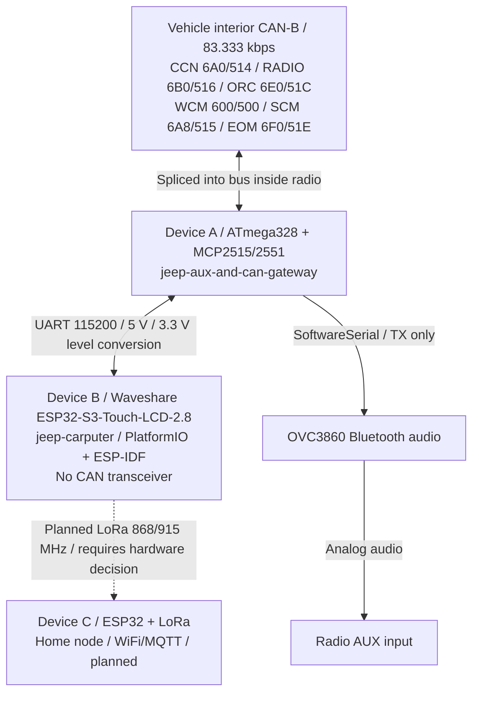
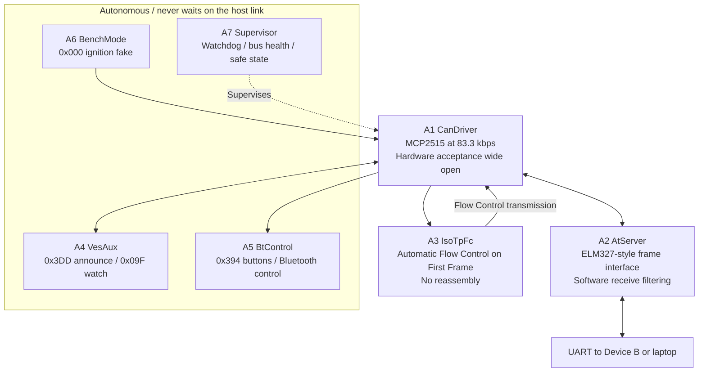
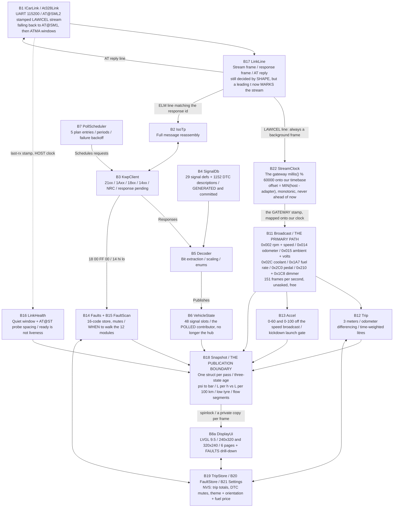
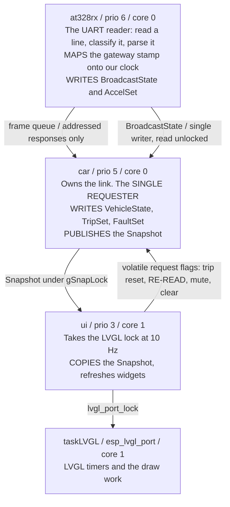
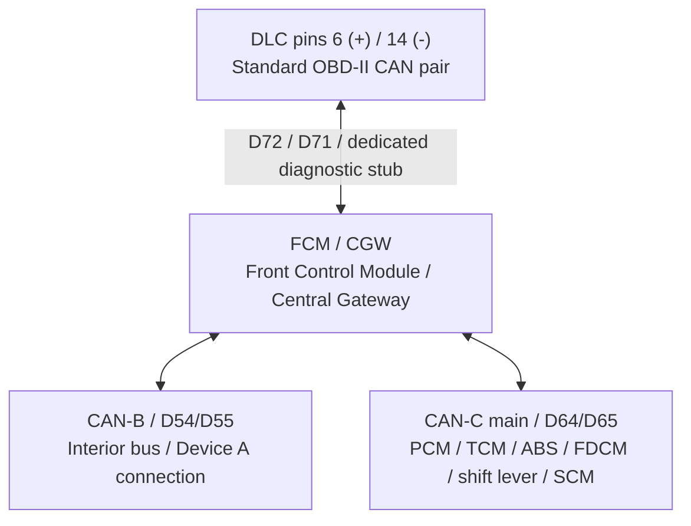

# Jeep in-car computer — system architecture

How the pieces fit together, across the whole project rather than one board. Written to
survive between sessions: the per-project detail lives in each folder's own README —
plus **`jeep-carputer/CLAUDE.md`**, which is the dashboard's engineering log and the
more detailed of the two for anything inside Device B (measured render timings, the
LVGL pool walls, layout arithmetic, and the product decisions that are settled).

* **Vehicle:** 2005 Jeep Grand Cherokee WH, interior **CAN-B bus at 83.333 kbps**.
  (Newer models run the interior bus at 125 kbps and call it "high-speed" — none of the
  ids here transfer.)
* **Guiding constraint:** the ESP32 has **no CAN transceiver**. The ten-year-old ATmega328
  board in the radio is the only path to the vehicle.

---

## The system

### Hardware and links

The CAN-B peers above reflect the recorded probe results. The FCM/CGW diagnostic
interface is on the DLC stub; see the [gateway topology](#gateway-topology) below.
Dashed links are planned. LoRa does not fit the current board's available GPIOs;
see the hardware reality check below.

### Device A: autonomous functions and frame link

The AT interface carries diagnostic frames but cannot control the autonomous
radio/AUX/Bluetooth functions. `AT@BENCH` is the documented bench-only exception.

### Device B: two data paths and one publication boundary

Device B is **shipping on the panel**, not planned: ~7.4k lines of hand-written
`jeep-carputer/src/` (plus 3.9k of generated font tables) and ~5.8k in
`jeep-carputer/core/` of which 1.4k is the generated signal database, six swipeable
pages in two orientations, and seventeen host-test suites that build and pass on a
laptop under address + undefined sanitizers (verified 2026-09-17).

The block ids below are the original ones. The *shape* is not: this document was
written around the polled path, and the **broadcast** path — which was not in the
original design at all — now carries almost everything the driver looks at. Polling
is what is left over for the handful of values the bus never volunteers.

Reading that in the order the data moves:

* **The reader routes three ways now, and the first branch is decided by SHAPE
  rather than by the id.** A LAWICEL line (leading `t`) is *always* a background
  stream frame and goes to the sink — it cannot belong to the transaction in
  flight, because the gateway routes a filter-matching frame to the ELM response
  path while a request is collecting and streams it otherwise. An ELM-shaped line
  under `AT@SML2` is therefore a request RESPONSE. Everything else is a reply.
  There is nothing wrong with the id comparison that used to do this job, and it
  is still there for the two fallback rungs where every frame arrives ELM-shaped:
  broadcast ids (`0x000`..`0x210`) cannot collide with a response id
  (`0x500`..`0x516`), so it never misrouted anything. What the shape buys is that
  the routing **no longer rests on that disjointness** — a new response id, or a
  frame arriving late from a filter that has since been changed, is a
  configuration change rather than a mis-attributed reading.
* **The broadcast path is the one that matters, and it is passive.** `0x002` carries
  rpm and speed every 50 ms for nothing, where a KWP read of the same two values
  costs a whole transaction and lands once or twice a second. So `kPlan` is
  deliberately tiny — fuel level, warning lamps, fluid-low flags, the four tyre
  pressures and the spare, five entries — and everything else is taken off the wire.
  Only CONFIRMED decodes are in `core/Broadcast.cpp`; ids the capture analysis
  marked merely plausible are absent on purpose, because a wrong number on a
  dashboard is worse than a missing one.
* **Three derived values hang off the broadcasts rather than off the hub.**
  `B12 Trip` differences the `0x014` odometer (never integrated speed) and
  time-weight integrates the `0x1A7` rate; `B13 Accel` times 0-60 from the speed
  broadcast alone, interpolating across the sample that crosses the line; `B11`
  itself derives the backlight per mille from `0x210` plus `0x1C8`.
* **`B6 VehicleState` is still the polled store** — 48 fixed slots keyed on a
  `SignalDef*`, each with its own timestamp — but it is now **one contributor to the
  snapshot, not the thing presenters read**. See invariant 3. Those 48 stamps are
  the **HOST's** and stay that way: a polled value is timed by when its transaction
  completed, and it is only the BROADCAST path that moved onto the gateway's clock
  (`B22`). Two clocks in one firmware is a thing to know rather than a thing to
  discover, so every stamp in this document says which one it is.
* **`B18 Snapshot` is where the vehicle stops and the screen starts.** One struct,
  resolved once per pass of the link task by `snapshotBuild()`, published under a
  spinlock, copied whole by the renderer at the top of each frame.
* **Two policy modules own timing and nothing else** — `B15 FaultScan` (when a DTC
  walk is owed, what an explicit RE-READ may interrupt, and the rule that a walk
  abandoned with the link down is owed *again immediately* rather than in five
  minutes) and `B16 LinkHealth` (quiet window, probe spacing, and the latch that
  keeps the last verdict standing until new evidence arrives). Both are pure and
  both are handed the clock, because that logic used to sit inside functions that
  owned a UART, a logger and two UI calls, where the only way to test "the cable was
  pulled" was to pull the cable.

`B9 GpsSource` / `B8c LoraTx` / `B8d TripLog` have **no counterpart in the tree** and
are dropped from the diagram rather than drawn as dashed boxes: nothing in the
shipped firmware anticipates them, and a dashed box reads as a socket waiting for a
plug. `B10 Platform` never became a module either — what exists of it is
`B21 Settings` for config and `ESP_LOG` over USB-Serial-JTAG for logging. There is
**no OTA** (single-app partition table), no explicit safe state, and no
task-watchdog configuration of our own beyond the IDF defaults.

No web UI: **LVGL only**, by decision. The deliberately throwaway first screen that
proved the data path also still exists — `src/UiLog.cpp`, the firmware's own log on
the glass — and it did its job: it is now **inert**, because `uiLogInit()` is never
called (the dashboard owns the LVGL port and both cannot). The `uiLogPrintf()` calls
still scattered through `main.cpp` silently drop their line. The test UI never
accreted into the real one; the real one was designed separately, as
`jeep-carputer/design/` artboards, exactly as this section asked.

### The four tasks, and who is allowed to write what

The earlier text described a `carTask` / `uiTask` split. There are **four** tasks,
and the one that was missing is where the primary data path actually runs.

* **`at328rx` is the writer of the broadcast state.** The reader loop's
  `sink_(f, streamClockMap(...))` *is* `onBroadcastFrame()`, so `broadcastApply()`,
  `accelUpdate()` and `accelTick()` all run on this task.
* **The stamp a broadcast arrives with is no longer OURS.** This line read
  `sink_(f, nowMs())` for the whole of the project's life before `AT@SML2` — the
  moment the reader task got round to the line — and it is now the time the
  **GATEWAY** saw the frame, mapped onto our timebase by `B22 StreamClock`. That is
  the point of the switch rather than a side effect of it: `B12 Trip`'s fuel integral
  and `B13 Accel`'s splits are `rate x interval` and `stamp - start`, so they are
  only as good as the intervals fed to them, and a reader stalled behind an NVS
  commit dequeues five queued lines microseconds apart and then waits — four
  intervals collapsing to nothing and the fifth swallowing the stall. Polled values
  are unaffected and stay on the host clock.
* **Accel is fed here on purpose:** `car` samples around a loop that
  contains a 700 ms monitor window in the ATMA fallback, and a launch timed off that
  would start its clock up to 700 ms early — a fifth of a brisk 0-60, all of it in
  the flattering direction. (`car` touches `BroadcastState` exactly once, calling
  `broadcastClear()` before it enters its loop to discard the bring-up era's stamps.
  The link is already streaming by then, so that one write can in principle land on
  top of a frame `at328rx` is folding in; the cost is at worst one dropped decode at
  boot. In steady state the writer is `at328rx` alone.)
* **The trips are NOT fed there**, and the asymmetry is the point: `car` also applies
  resets and commits to NVS, so it must be the only writer of `TripSet`. It samples
  `gBcast` every 20 ms instead, faster than the quickest frame on the bus.
* **Nothing is locked except the snapshot.** Every other structure keeps
  single-writer discipline, and `gSnapLock` guards `gSnapLive` and nothing else — a
  lock around the *read* of a structure that is written unlocked buys nothing while
  looking like it bought something. It is a spinlock rather than a mutex because
  neither side may sleep: ~650 bytes is a couple of microseconds, far less than
  either side would lose blocking.
* **The renderer requests; it never mutates.** A trip reset, a RE-READ, a mute and a
  clear are volatile request flags consumed on `car`. The clear travels as
  `(ecu, code)` rather than a list index, because a scan completing between the tap
  and the consumption renumbers the list and an erase cannot be undone.
* **One thing is touched from two tasks, knowingly:** `applyBacklight()` runs both on
  `at328rx` (the instant `0x210` lands, so a dimmer wheel the driver is turning
  responds now rather than up to two seconds later) and on `car` (the fail-bright
  failsafe for when the frame stops). They share one `static uint16_t applied` latch,
  so the worst the race can produce is a duplicate LEDC write and a duplicate log
  line.
* **`ui` and `taskLVGL` are both on core 1**, away from the link. The link task
  blocks on UART reads for up to 400 ms at a higher priority, so on a shared core a
  poll burst stalls the display outright — which reads as a low frame rate rather
  than as the priority inversion it is. Note the snapshot is copied by `ui` under
  `lvgl_port_lock`, not by `taskLVGL` itself; the comments in `Ui.h` and `main.cpp`
  say "the LVGL task", which is the lock, not the thread.

## Hardware reality check on Device B

Established from the Waveshare schematic, not assumed:

* **No CAN transceiver on the board**, confirming the premise this whole architecture rests on. The
  S3 has a TWAI controller but no internal transceiver, so CAN-C would need an external one.
* **Only four usable GPIOs**, all on JST-SH 1.0 mm connectors rather than 0.1" headers, so the
  supplied cables are mandatory: **IO43/IO44** (UART0) and **IO15/IO18** (J8 spares, also wired to
  SD_D1/SD_D2 with 10k pull-ups). Everything else is committed to the LCD, touch, octal PSRAM
  (IO33-37), flash, TF card, I2S audio, IMU/RTC I2C, battery sense and USB.
* UART0 is genuinely free: there is no USB-serial bridge chip, USB-C goes straight to GPIO19/20, so
  the console is native USB-Serial-JTAG and printf debugging coexists with the link.
* Caveat on that: the **ROM bootloader prints its boot log on U0TXD (IO43) at every reset**
  regardless of console config, so the 328 sees noise whenever the ESP32 restarts. Harmless -- the
  328 answers `?` to anything unparseable -- but the link handshake drains before starting.
* PSRAM is **octal**, and the S3 Kconfig defaults to quad at 40 MHz. Wrong mode means the board does
  not boot. `sdkconfig.defaults` sets `SPIRAM_MODE_OCT` + `SPIRAM_SPEED_80M`. Not 120 MHz: that is
  gated behind experimental flags and warns of PSRAM corruption after a ~20 C temperature swing,
  which is precisely what a car interior does.
* Touch controller depends on board revision -- **V1 = CST328, V2 = CST3530** (shipping since
  2026-06-05). Different registry components with different APIs. The label on the back decides.

### LoRa does not fit, and that reshapes the roadmap

The link takes IO43/44 and a GPS UART takes IO15/18. That is every free pin. LoRa needs five or six
(SCK/MOSI/MISO/CS/RST/BUSY) and the only way to find them is to share the LCD's SPI3 bus or the TF
card's pins -- neither of which is broken out, so it means soldering to the LCD flex or the card
socket.

So the 2.8 is a display board, not the car unit. The cleaner split is to keep it as the LVGL/UI
development board -- it is genuinely good at that, with 8 MB octal PSRAM and a clean SPI panel -- and
put the I/O-heavy role on something with pins. A board carrying an **onboard CAN transceiver** would
also collapse the biggest open question in this document: the ESP32 could sit directly on CAN-C, which
makes the `7E0` gateway-forwarding test irrelevant and puts all 1152 DTCs plus live engine data in
reach without depending on the cluster's mirrored values at all. That is a decision to take
deliberately, not by drift.

**Amend that first sentence with what was built since.** Device B as it ships needs
exactly two pins — UART0 to the radio — so the 2.8 is a *sufficient* car unit for
everything currently on the glass, and it is the board the dashboard is developed,
measured and flashed on. The "display board, not the car unit" conclusion still
stands for **LoRa and GPS specifically**, which remain unstarted and still have
nowhere to go; it is not a statement that the 2.8 has been set aside.

### Toolchain

PlatformIO + `framework = espidf`, on **Windows** (`pio run -e s3`), building the
whole dashboard including managed components. The friction this section predicted
arrived, and neither of the two escape hatches was needed — no vendoring into
`components/`, no move to native `idf.py`. What it cost instead:

* **`lib_ldf_mode = off` is load-bearing.** Every dependency comes from
  `src/idf_component.yml` into `managed_components/` — LVGL **9.5.0**,
  `espressif/esp_lvgl_port` 2.9.0, `waveshare/esp_lcd_touch_cst328` 2.0.0. The
  Library Dependency Finder knows nothing about that and also scans
  `~/.platformio/lib`; a machine with an LVGL **8** installed there compiles it
  alongside and dies on `lv_btnmatrix_ctrl_t` and a wall of v8-only symbols. The
  build used to live in WSL, whose PlatformIO home happens to have no such library,
  which is the only reason this never showed up before the move.
* **The move to Windows bumped ESP-IDF silently**, 5.3.2 → **5.5.4** in
  `dependencies.lock`, because the Windows PlatformIO ships a newer
  `framework-espidf`. LVGL did not move — same 9.5.0, same component hash. The build
  is clean and the board boots on it, but that is a whole IDF minor arriving as a
  side effect of changing machines: **suspect it first** if something that used to
  work stops.
* The ST7789 panel driver is deliberately not a dependency: it is built into
  ESP-IDF's `esp_lcd`. There is no board-level BSP for this Waveshare board, so the
  glue is assembled from published pieces rather than copied out of their demo.

---

## Why it is split this way

Three invariants carry the whole design. Everything else is negotiable.

**1. The car never depends on the host.** `A4`/`A5`/`A6` are driven only by what they see on
the bus. They never wait on the UART, and the AT surface has no command that can reach
them — no way to change the radio source, stop the VES announce, or power the Bluetooth
module. Unplug Device B, or plug in a laptop running something broken, and the car behaves
exactly as it did in 2015. `AT@BENCH` is the single exception and is meaningless in a car.

This is also why Device A applies the host's `ATCRA`/`ATCF` filter **in software** and
leaves the MCP2515's hardware acceptance wide open: a hardware filter set for a diagnostic
session would stop `0x09F` and `0x394` reaching the controller at all, freezing the
Bluetooth power pin and killing the seek buttons for the duration — which is the normal
running state once Device B is polling. Same reason `ATZ` does not re-initialise the CAN
controller: a host resetting in a loop would stall the VES announce and the head unit
would drop AUX.

**2. The link carries frames, not meanings.** There is no `GET_TPMS`. Device A is a dumb
frame pipe, so its firmware is written once and never changes as Device B grows features.
All the interpretation — ISO-TP reassembly, KWP parsing, PID decoding, scaling — lives on
the ESP32 where there is RAM, flash and a debugger. The one exception is `A3 IsoTpFc`,
because the *adapter* must auto-send the Flow Control frame or every multi-frame reply
(i.e. every DTC list) stalls forever.

"Written once and never changes" held for the *meanings* and not quite for the
firmware: Device A went **2.0 → 2.1** to add duplex streaming, so requests and
broadcasts can overlap instead of alternating. It arrived as **two stream formats
sharing one level field** — `AT@SM<n>`, the ELM327 shape, and `AT@SML<n>`, true
LAWICEL/SLCAN with a DLC nibble and an optional rolling stamp — and Device B now asks
for **`AT@SML2`**, down a **three-rung ladder**: `AT@SML2`, then `AT@SM1` (the overlap
without the stamps), then the ATMA windows against a 2.0 adapter. Three rungs because
each one is a real adapter, and any of the three works with this host.

That is still a statement about frames and not about the car — it changes *when*
frames may be sent and *what a line looks like*, not what any of them means. The
stamp is the closest this has come to the line, and it stays on the right side of it:
it says when the GATEWAY saw a frame, which is a fact about the wire. The invariant
that actually mattered survived: nothing was added to the AT surface that knows what a
tyre pressure is.

**3. Exactly ONE structure crosses from the vehicle to the screen.** A new screen
never touches protocol code: sources publish, presenters subscribe.

This invariant used to read "`B6 VehicleState` is the only thing presenters can see",
and for most of the project's life **that was false four ways out of five**. `Ui.cpp`
was handed five pointers at startup — the hub plus raw `BroadcastState`, `TripSet`,
`AccelSet` and `FaultSet` — each to a structure another task was still mutating.
Mostly benign: every field is four bytes or fewer and naturally aligned, so a torn
*value* was never the risk. Three things were real.

* **A torn STRUCTURE.** `faultsEndScan()` insertion-sorts the fault list while the
  drill-down is walking it, so a row could be drawn twice or skipped — not a wrong
  number, but a wrong *list*, on the page whose whole job is saying what is wrong.
* **Nothing agreed about "now".** Each readout sampled the clock in its own refresh
  function, so two numbers in the same frame could be judged against different
  instants and one could be fresh while the other went stale.
* **Staleness was implemented five times** — `VS_DEFAULT_TTL_MS`, `UI_TYRE_TTL_MS`,
  `UI_SPARE_TTL_MS`, `BACKLIGHT_SIGNAL_TTL_MS`, `BC_PEDAL_TTL_MS` — in a translation
  unit bound to LVGL and therefore impossible to host-test, with two of them
  requiring hand-synchronisation with `kPlan` in `main.cpp`.

So the crossing is now explicit, in one direction, through **`core/Snapshot.h` /
`Snapshot.cpp`**. `snapshotBuild()` resolves one `Snapshot` per pass of the link
task; `publishSnapshot()` in `src/main.cpp` copies it into `gSnapLive` under a
spinlock; the renderer pulls its own private copy once per frame through the
function pointer given to `uiSetSnapshotReader()`. A rendered frame is internally
consistent **by construction**, and the whole of the deciding is in pure C++ the
laptop can run.

The snapshot resolves, in one place:

* a **three-state age** per value — `SNAP_ABSENT` (nothing known, or an explicit
  all-ones sentinel → dashes), `SNAP_HELD` (a real reading past its TTL → show it,
  dimmed), `SNAP_FRESH`. Collapsing HELD into FRESH is the frozen-but-plausible
  failure the whole instrument exists to avoid; collapsing it into ABSENT throws
  away a good reading and makes the panel flicker;
* **broadcast beats polled** for the five values that exist on both paths, and a
  HELD broadcast beats a FRESH poll on purpose — they are readings of the same
  quantity, so switching source mid-glance would change the number for a reason
  that has nothing to do with the car;
* the presentation arithmetic that was trapped in `Ui.cpp` and could not be tested
  without a board and a car: psi → bar, the L/h ↔ L/100km switch **and its two-sided
  hysteresis**, the low-corner test, the flow bar's segment count.

**`B6 VehicleState` is now one contributor to that snapshot — the polled one — and
not the hub presenters read.** The broadcast path could not be folded into it, and
that is a property of the hub rather than an oversight: a `VehicleState` slot is
keyed on a `const SignalDef*` and holds the last scaled value of one KWP read, with
its timestamp. `0x1A7` is not that. It is a *rate* (L/h = Q/160) which has to be
integrated time-weighted per frame, with `0xFFFF` dropping the interval; what the
screen wants out of it is litres, a smoothed L/h and a cost — accumulations over
hundreds of frames. Same for the `0x014` odometer, which is differenced, and for the
0-60, which is interpolated across a 50 ms sample. A slot can hold a number; it
cannot hold an integral.

What did **not** move into the snapshot: anything about layout, colour, fonts or
geometry. It decides *what* to say and *how much to believe it*. `Ui.cpp` still owns
entirely how it looks.

---

## Blocks

### Device A — ATmega328 (built, flashed, running in the car at firmware 2.1)

| Block | Responsibility |
|---|---|
| `A1 CanDriver` | MCP2515 @ 83.3 kbps / 16 MHz behind `ICanBus`; bounded init, bus-off recovery, saturating counters |
| `A2 AtServer` | ELM327-style line protocol; software-side frame matching; `AT@` extensions; implements `IEventSink` |
| `A3 IsoTpFc` | Frame classification + the auto Flow Control frame. No reassembly |
| `A4 VesAux` | `0x3DD` announce every 500 ms; `0x09F` low nibble `== 6` → AUX → BT power pin |
| `A5 BtControl` | `0x394` byte 3 → OVC3860 `AT#MD`/`AT#ME`/`AT#MA`, debounced; one-slot deferred send while the link is busy |
| `A6 BenchMode` | `0x000` ignition fake, EEPROM-persisted runtime toggle |
| `A7 Supervisor` | Watchdog, RX-silence detection, re-init, safe state, uptime and free RAM |

### Device B — ESP32-S3 (shipping; six pages on glass, two orientations)

Everything in the first table exists and is called from the shipping firmware unless
the row says otherwise, and every `core/` module now has a host suite of its own.
**This paragraph used to name `B11 Broadcast` as the one exception that had none**,
exercised only indirectly through the Trip and Accel tests and through
`scripts/replay-accel.cpp`, which replays 126,183 real frames from an 841 s drive
through `core/` on the laptop. That is no longer true: `test/test_broadcast/` exists,
so a new id decoded into `broadcastApply()` does get a direct test. The replay harness
stays, because running a whole real drive through the real decoders answers a
different question from a suite — it is what found the `0xFFFF` speed sentinel and
the fourteen false launch triggers, neither of which anyone would have thought to
assert.

| Block | File | Responsibility |
|---|---|---|
| `B1 ICarLink` | `core/CarLink.h`, `src/At328Link` | Frames over the UART link, negotiating `AT@SML2` → `AT@SM1` → the ATMA windows, and **silencing whatever the 328 was already streaming before it sends `ATZ`**. **One implementation only** — `At328Link`. `ElmSerialLink` and `ReplayLink` were never written; desk work is `scripts/emulate-car.py`, which emulates the 328 *and the modules behind it* over a real UART (it replaced `replay-lawicel.py`, recoverable from tag `v1.1`, which could only replay), plus `scripts/replay-accel.cpp` running `core/` on the laptop |
| `B2 IsoTp` | `core/IsoTp` | Single/First/Consecutive handling, reassembly into complete PDUs |
| `B3 KwpClient` | `core/Kwp` | Request builders, `+0x40` positive-response rule, negative codes, `7F xx 78` pending, `18 00 FF 00` DTC read, `14 hi lo` single-code clear, raw code → SAE string (verified against all 1152 pairs) |
| `B4 SignalDb` | `core/SignalDb.cpp` | **Decided, and shipped: a generated flash table.** 29 signal defs and 1152 DTC descriptions (~61 KB of image), generated by `tools/gen_signals.py` from the extracted vendor CSVs and **committed**, so the firmware builds with no vendor data present. Not LittleFS, and deliberately not a build step |
| `B5 Decoder` | `core/Decoder` | Bit extraction and scaling. Conventions: **big-endian bytes, LSB-first bits, offset counted from byte 0 of the full response** |
| `B6 VehicleState` | `core/VehicleState` | 48 fixed signal slots, each with raw, scaled value, label and timestamp. The **polled contributor** to the snapshot |
| `B7 PollScheduler` | `core/PollScheduler` | Round-robin over a static plan with per-entry periods and exponential failure backoff. Five entries today. `setSuspended()` is **built and host-tested but never called from `src/`** — see below |
| `B8a DisplayUi` | `src/Ui.cpp` (3.6k lines) | LVGL 9.5 on 240×320 and 320×240, six peer pages plus splash, the FAULTS drill-down and its dialog, palettes, and the runtime orientation flip |
| `B11 Broadcast` | `core/Broadcast` | **The primary data path.** Passive decode of the ids the bus emits unasked, at 151 frames/s: rpm, speed, odometer, coolant, ambient, volts, ignition, fuel rate, pedal, dimmer and lights, each with its own arrival stamp — the **gateway's**, mapped by `B22`, on the `AT@SML2` path, and the host's on both fallbacks |
| `B12 Trip` | `core/Trip` | Three meters (A and B persisted, FROM START cleared every boot). Distance from odometer differences; litres from time-weighted integration of the `0x1A7` rate; a trip does not run while the engine does not, and **stale rpm is a third state** that pauses the clock without moving the anchor |
| `B13 Accel` | `core/Accel` | 0-60 and 0-100 from the speed broadcast alone. Arms only from a genuinely observed standstill, times from the last stationary sample, interpolates the crossing sample, and requires the kickdown detent within `ACCEL_LAUNCH_MS` or the run is thrown away |
| `B14 Faults` | `core/Faults` | 16-code store, one module per pass of the link task, `answered` and `unreachable` as separate masks, and the mute list matched on `(ecu, code)` |
| `B15 FaultScan` | `core/FaultScan` | *When* to walk: once the link comes up, then every five minutes; RE-READ stays owed until honoured; a walk abandoned with the link down is owed again immediately. Decides, never transacts |
| `B16 LinkHealth` | `core/LinkHealth` | Link liveness: `ready()` is not liveness, so silence raises a *question* (`AT@ST`) rather than a verdict, probes are spaced, and the verdict is a latch |
| `B17 LinkLine` | `core/LinkLine` | Telling a LAWICEL stream frame, an ELM-shaped request response and an AT reply apart with nothing but the shape of the line. **Two parsers, and the asymmetry is the point:** the LAWICEL one DERIVES the stamp width from the line's own DLC nibble and hands it back to be checked, the ELM one has to be TOLD a width it cannot verify. 57k checks in its host suite |
| `B18 Snapshot` | `core/Snapshot` | **The publication boundary.** One resolved struct per pass: three-state age for every value, broadcast-beats-polled, psi→bar, the flow unit and its hysteresis, the low-tyre test, the flow segment count |
| `B19 TripStore` | `src/TripStore` | Trip A/B totals in NVS, rate-limited per meter, immediate on a reset |
| `B20 FaultStore` | `src/FaultStore` | The DTC **mute list** in NVS — the decisions, never the faults themselves, which live in the modules. Must load *after* `tripStoreInit()`, which is what brings NVS up |
| `B21 Settings` | `src/Settings` | One blob: theme, orientation (portrait plus two landscapes), fuel price in whole cents. Every field must be sane when NVS is empty |
| `B22 StreamClock` | `core/StreamClock` | The gateway's rolling `millis() % 60000` onto our timebase. The offset is a **MINIMUM** of `host - adapter`, because `host = adapter + offset + latency` and latency is never negative, with a ~977 ppm upward creep so real crystal drift is still tracked. It guarantees `mapped <= hostMs` (every unsigned `now - stamp` age downstream stays an age instead of underflowing to 4.29 billion) and that `mapped` never decreases. A gap past the 60 s modulus is bucketed by the host clock and timed by the stamp; a gateway reboot needs no special case, since a minimum-filter takes the corrected offset in one sample |

Supporting IDF-side modules, outside the block numbering: `src/Display` (SPI3 +
ST7789 bring-up), `src/Touch` (CST328 as an LVGL input device — deliberately *not*
part of the rotation), `src/UiTheme` + `src/UiPalettes.inc` (generated palettes), and
`src/UiLog` (the original throwaway log screen, still compiled and called but inert).

**Aspiration, still:**

| | State |
|---|---|
| `B7 PollScheduler::setSuspended()` | **Built, host-tested, unwired.** Nothing in `src/` ever calls it, so the "suspend when the ignition is off" responsibility this table used to assert is not happening. `bcast.ignition` is decoded and available; the scheduler is simply never told |
| `B9 GpsSource` / `B8c LoraTx` / `B8d TripLog` | Not started, no file, no call site |
| `B10 Platform` | Never built as such. Config is `B21`; logging is `ESP_LOG`; no OTA, no explicit safe state |

Protocol and policy logic in `core/` is written with **zero ESP-IDF dependencies** —
no `esp_log`, no `esp_err_t` in signatures — so it compiles in a host build and is
unit-tested there. That rule now covers far more than the original `B2`-`B5`: every
`core/` file above is pure, including the three derived-value modules, the two policy
modules and the snapshot. `scripts/run-host-tests.sh` builds each `test/test_*/`
directory against the whole of `core/` with `-fsanitize=address,undefined`.
IDF-dependent code stays in `B1`'s implementation, `B8a`, `B19`-`B21` and the
supporting modules.

---

## What the cluster and gateway give us

The finding the project rests on: `CCN` and `FCMCGW` are both CAN-B peers, and both mirror
CAN-C-sourced values in their own PIDs — necessarily, since the cluster has to receive RPM
and coolant temperature in order to display them. So **the whole dashboard is reachable
from the interior bus with no transceiver.**

Two things to hold in mind while reading the table below, both established in the car
on 2026-09-11 and both discussed further down this document:

* **The `FCMCGW` column is documented but NOT reachable from CAN-B.** The gateway's
  diagnostic interface is on the DLC stub, so it never answers at `620/504` from the
  interior bus. The column is kept because it is what a DLC tap would buy.
* **The shipped dashboard barely polls this table.** Rpm, speed, coolant, ambient,
  volts, odometer and ignition all arrive on BROADCASTS (`0x002`, `0x02C`, `0x015`,
  `0x014`, `0x000`) for nothing, which is faster and cheaper than any `21xx` read of
  the same value. The live poll plan is five entries: `CCN 2103`, `213F`, `2135` and
  the two WCM tyre requests.

| Domain | `CCN` 6A0/514 | `FCMCGW` 620/504 |
|---|---|---|
| Engine | `213E` RPM, speed, distance per wheel; `2140` coolant temp, throttle | `21B1` RPM, PRND; `21B0` speed |
| Trip | `2103` fuel level %; `213E` distance L/R | `21A3` **odometer**; `210C` tire circumference, axle ratio |
| Faults | `213F` MIL, oil, ABS, ESP, charging, water-in-fuel, wait-to-start lamps | `2140` lamp/relay states |
| Environment | `2134` ambient temp, system voltage; `2152` compass | `2110` ambient, battery V + temp; `2111` A/C pressure |
| Fluids | `2135` washer/coolant/brake low flags | `2112` washer level; `2113` brake + coolant level |
| TPMS | `2130` pressure indication, TPM localisation, chime | `210B` TPMS + TPMS Premium config bits |
| Body | `2110` doors/liftgate ajar, parking brake, seat belt; `2149` ParkSense | `2120` hood ajar, brake switch, reverse; `2101` wheel speed |
| Identity | `1A88`/`1A90` VIN | `1A88`/`1A90` VIN |

Two caveats that shape the UI:

* `CCN 213F` reports that the **MIL is lit**, not which P-code lit it. Per-code engine faults
  live in `PCM` on CAN-C.
* **Per-wheel psi turned out to exist after all, and the database does not know about
  it.** This entry used to read "no per-wheel psi PID exists ... real pressures would
  need the TPMS Premium variant". Wrong: the **WCM answers an undocumented service-21
  range** — `21 3B` returns all four road wheels in one reply, `21 20`..`21 24` return
  one sensor each with the fifth being the spare, **one psi per bit, no offset, no
  scaling**. Confirmed three independent ways in the car (the owner's expected band,
  one genuinely soft corner, and a stored `C0077` "Low Tire Pressure" on the WCM), and
  hand-written into `core/TpmsSignals.h` because a generated table can only emit what
  the vendor database contains. That is what makes TPMS the hero feature rather than a
  warning lamp. **Corner order is still UNMAPPED** — `21 3B` byte *k* matches
  `21 (0x1F+k)` in 11 of 11 recorded pairs, so they are sensors 1..4 in index order,
  but which physical wheel each one sits on is unknown and the screens say `SENSOR 1`..`4`
  rather than guessing.

DTC coverage on the interior bus, no gateway hop needed — all use `18 00 FF 00`:

| Reachable now | codes | | Needs CAN-C | codes |
|---|---:|---|---|---:|
| ORC airbag | 185 | | PCM engine | 226 |
| FCMCGW gateway | 176 | | TCM transmission | 84 |
| WCM immobiliser | 93 | | ABS | 82 |
| CCN cluster | 88 | | FDCM AWD | 76 |
| SCM steering column | 53 | | ESM shifter | 8 |
| RADIO | 51 | | | |
| EOM overhead | 30 | | | |
| **676 (59%)** | | | **476 (41%)** | |

> **Measured results are in
> [jeep-aux-and-can-gateway/docs/CAN-B-CAPABILITIES.md](jeep-aux-and-can-gateway/docs/CAN-B-CAPABILITIES.md)**
> — what CAN-B actually gives us, what is missing, and what the gaps cost.
> Raw evidence in [PROBE-LOG.md](jeep-aux-and-can-gateway/docs/PROBE-LOG.md).

### ANSWERED 2026-09-11: CAN-C is not reachable from CAN-B, and the fix is a connector

Tested in the car with the ignition on **and** with the engine running. All five CAN-C
modules were addressed from the interior bus and none answered: PCM `7E0`, TCM `7E1`,
ABS `784`, FDCM `7B6`, ESM `788`. An exhaustive sweep of every request id `600`..`6FF`,
with the receive filter opened across the whole `500`..`5FF` response range, found
**exactly six responders** -- CCN, RADIO, ORC, WCM, SCM, EOM -- and nothing else.

The factory schematics (`temp/Jeep WK Schematics.pdf`, Fig. 8/9) explain why:

#### Gateway topology

The gateway translates selected signals between the buses. Diagnostic requests
from the CAN-B side were not forwarded to CAN-C in the recorded tests.

`D71`/`D72` touch exactly two things in the entire vehicle: the Data Link Connector and
the FCM. The gateway routes between **that stub** and the two buses -- which is what a
scan tool plugs into -- and it translates selected *signals* B<->C (how the cluster gets
RPM to display) but does not route diagnostic *requests* arriving from the CAN-B side.
Our board is spliced onto CAN-B, behind the gateway, so a `7E0` request lands on a bus
where no PCM exists.

This also corrects the earlier note above about "no SGW hop": there **is** a gateway, it
is the Front Control Module, and the reason it never answered at `620/504` is that its
diagnostic interface is on the stub rather than on CAN-B.

**Consequence, and it is a cheap one.** The dashboard is built on CCN mirrors today, and
CAN-C is one connector away rather than a harness splice: **tap DLC pins 6 and 14**, the
standard OBD-II CAN pair, so an OBD-II pigtail plugs straight in under the dash. Behind
it is the gateway and through it the whole CAN-C side -- PCM 226 PIDs, TCM 84, ABS 82,
FDCM 76, ESM 8, and 476 DTCs. Cost is one ~$2 transceiver at 500 kbps.

The ESP32-S3's native TWAI controller is left deliberately unused, so that
transceiver can put Device B straight onto CAN-C later with no architectural change.

---

## Status

| | State |
|---|---|
| Device A firmware | **Built, 38 host tests pass, flashed over ICSP and running in the radio at 2.1** — `AT@SM` / `AT@SML` duplex streaming, so requests and broadcasts overlap; the host asks for `AT@SML2`, stamped LAWICEL. Flash backups pulled off the chip 2026-09-11 |
| Device A bench regression | **Still not formally done.** The gate is unchanged: radio still offers VES and BT power still follows AUX, with the UART both connected and unplugged. The board has since run in the car for real sessions, which is evidence but not this test |
| In-car probe session | **Done, 2026-09-11**, engine off and running. Results in `jeep-aux-and-can-gateway/docs/CAN-B-CAPABILITIES.md`, raw evidence in `PROBE-LOG.md`. Six CAN-B responders found, CAN-C proven unreachable, and the bus measured at **151 frames/s** |
| Device B | **Shipping.** Six pages on glass in two orientations, the broadcast path, TPMS, three trip meters, DTC reading with 1152 compiled-in descriptions, acceleration timing, three NVS stores. 17 host suites pass under ASan/UBSan |
| Device B on the car, verified | Partial. The data path, the pages and the frame rate are measured on the board; **which 90° landscape is** was picked without glass, and `Q/160` has never been checked against fuel actually paid for |
| Device C, LoRa, GPS | Not started. No file, no call site, no pins |

Open decisions: **`B4` storage is settled** — a generated, committed flash table
(`core/SignalDb.cpp`), not LittleFS. What is left is free GPIO on the
ESP32-S3-Touch-LCD-2.8, which only matters for LoRa and GPS — they need SPI plus a
UART, and sharing the TF card's SPI bus is probably what makes them fit. Also still
open, and cheap: **tapping DLC pins 6 and 14** to reach CAN-C behind the gateway.
