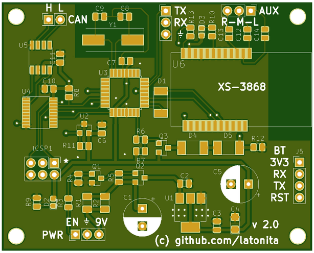

# jeep-canbus   

Projects around CAN BUS in Chrysler Jeep - VES enabler, other small features

PCB for Aux + bluetooth based on xs3868 v3.0 added.

Here is CAN ID map I collected on CAN-B:

[Jeep Grand Cherokee WH 3.0 CRD - CAN-B — complete observed ID/byte map](JEEP-WH-CRD-CAN-ID-byte-map.md)

The same map as a DBC file for SavvyCAN, cantools, Vector tools etc.:

[jeep-wk-wh-crd.dbc](jeep-wk-wh-crd.dbc). It covers CAN-B at 83.333 kbit/s with
11-bit IDs: 59 messages and 180 signals with scales, value tables and cycle
times. Each signal has a `Confidence` attribute (Confirmed / Probable /
Candidate / Unknown / OwnerStated). `FF`/`FFFF` "unavailable" values decode as
maximum values, so check for them in your consumer.
