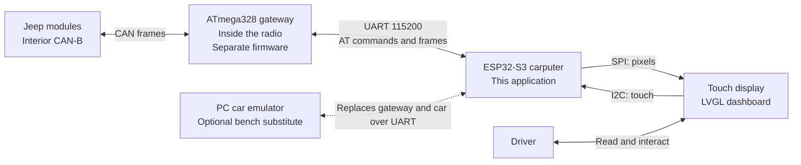
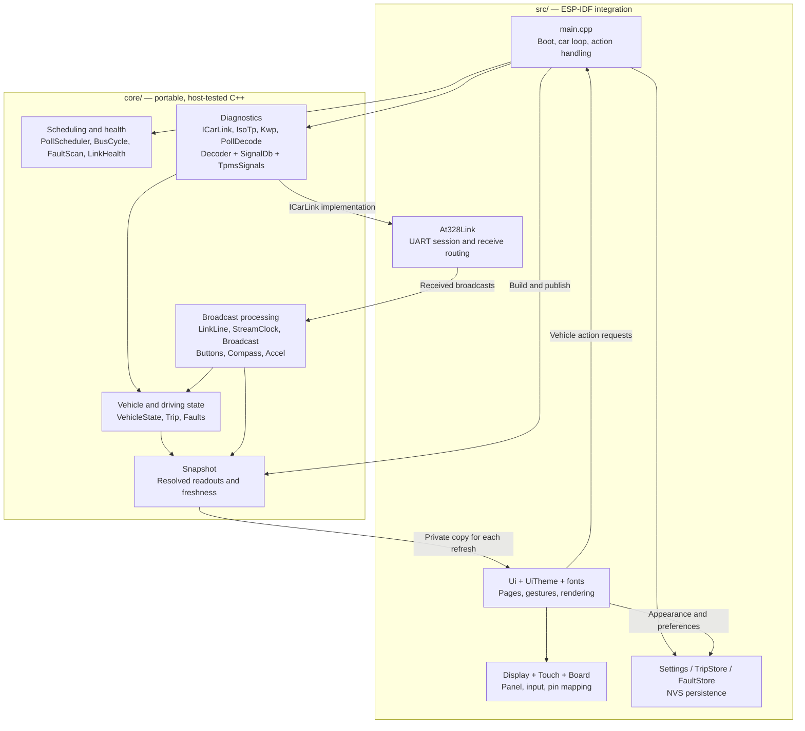
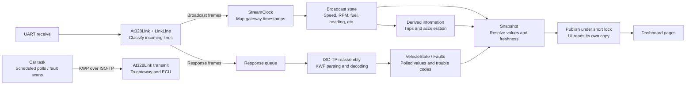
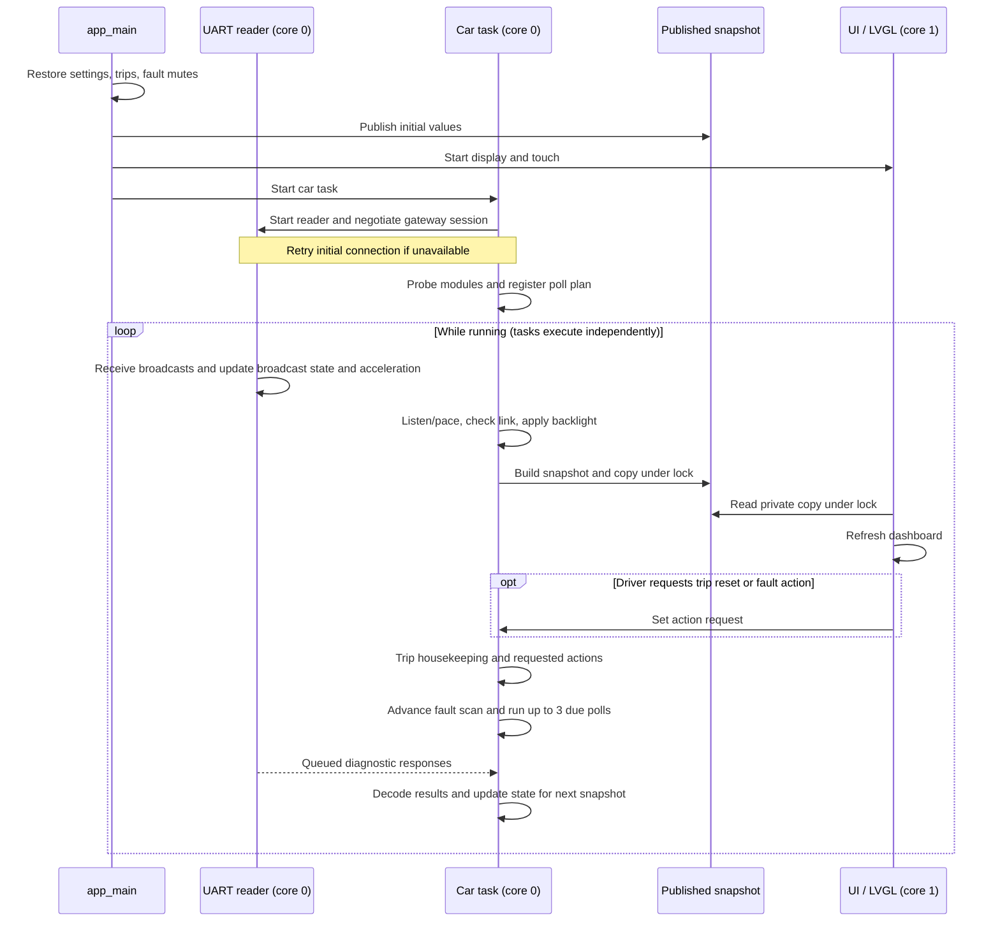

# App architecture

A compact view of the current implementation, based on the source as of 2026-09-17.
The app is an ESP32-S3 dashboard: it receives vehicle data through the radio's
ATmega328 gateway, calculates driving information, and displays it with LVGL.

The four diagrams below cover **where it runs**, **what it contains**, **how data
moves**, and **how it runs over time**. Mermaid diagrams render directly on GitHub
and in Markdown viewers with Mermaid support.

## 1. System context

The ESP32 has no direct CAN connection. The external gateway carries both vehicle
broadcasts and diagnostic requests over one UART link.

The gateway's audio/Bluetooth responsibilities remain in its own firmware. Vehicle
protocol handling and interpretation happen in this app.

## 2. Component diagram

`src/main.cpp` wires the system together. `core/` holds portable C++ logic;
`src/` supplies ESP-IDF hardware access, tasks, storage, and presentation.
Arrows show calls or supplied data, rather than every include dependency.

The snapshot is the main vehicle-data boundary: it resolves values, units, warnings,
and whether readings are fresh, held, or absent. The UI owns their visual appearance.
Link status, logs, and page-change notifications also have small direct UI interfaces.

## 3. Data flow: two ways to learn about the car

Broadcasts provide frequent driving data. Scheduled diagnostics fill in information
that broadcasts do not supply, such as tyre pressures and warning flags.

Fresh readings display normally; old readings remain visible but dimmed; unknown or
explicitly unavailable readings become dashes. Trips A/B and fault mute choices are
saved to flash; the “from start” trip begins again at boot.

Broadcast button events also request page changes, and dimmer/light frames control
the backlight. These short paths do not wait for diagnostic polling.

## 4. Runtime sequence and task boundaries

The UART reader and car task run on core 0; UI refresh and LVGL run on core 1.
Only the car task issues vehicle requests. The reader keeps receiving while a
diagnostic transaction waits for a reply.

Normal operation uses continuous background streaming. Older gateways fall back
to alternating monitor windows and requests; if monitoring is unavailable, the
loop can run polls alone. The normal streaming delay is 20 ms, but diagnostic waits
can extend a loop pass. Snapshot publication is protected; building it reads live
inputs outside that lock, so it is not an atomic capture of every producer.

## 5. Data sources and read intervals

All vehicle reads pass through the ATmega328 gateway. Broadcast IDs below identify
the received CAN frames; they do not imply a direct ESP32 connection to the sending
module. Broadcast timing is vehicle-controlled, not an app polling schedule.

### Passive broadcasts

| Data read | CAN frame | Arrival timing documented in code | Used for |
|---|---|---|---|
| Engine RPM and vehicle speed | `0x002` | About 50 ms | Gauges, acceleration timing, consumption |
| Odometer | `0x014` | On receipt; rate not specified | Trip distance |
| Ambient temperature and battery voltage | `0x015` | On receipt; rate not specified | Dashboard / health |
| Engine coolant temperature | `0x02C` | On receipt; rate not specified | Dashboard / health |
| Ignition / key position | `0x000` | On receipt; rate not specified | Trip lifecycle |
| Instantaneous fuel flow | `0x1A7` | About 100 ms | Consumption and accumulated trip fuel |
| Accelerator pedal | `0x2C0` | About 100 ms | Pedal display and acceleration launch detection |
| Fuel tank level | `0x159` | About 1 s | Fuel gauge |
| Compass direction, heading and status | `0x1B4` | About 500 ms | Compass |
| Panel dimmer level | `0x210` | On receipt; rate not specified | Screen brightness |
| Exterior lights state | `0x1C8` | About 500 ms | Day/night brightness behavior |
| Head-unit button bits | `0x394` | Press/release events | Page navigation |

Source: [Broadcast.cpp](../core/Broadcast.cpp) and the broadcast handlers in
[main.cpp](../src/main.cpp). These values are not periodically requested by the app.
In particular, fuel level comes from `0x159`; the older `21 03` fuel poll is no longer
in the active plan.

### Diagnostic requests

CCN is the instrument cluster; WCM is the wireless control module that supplies
tyre pressures. Request bytes below are KWP payloads, before ISO-TP framing.

| Data read | Module / request | When requested |
|---|---|---|
| ABS lamp, charging failure, check-engine (MIL) lamp, oil lamp flags | CCN / `21 3F` | Every **5 s** |
| Washer fluid low, engine coolant low, brake fluid low flags | CCN / `21 35` | Every **10 s** |
| Four road-wheel tyre pressures | WCM / `21 3B` | Every **60 s**, one request for all four |
| Spare tyre pressure | WCM / `21 24` | Every **60 s**, separate request |
| Stored trouble codes and their status | Each configured module / `18 00 FF 00` | First scan after connection, then **5 min after the previous scan finishes**, or driver RE-READ |
| ECU identification and initial trouble-code reads | RADIO, CCN, WCM / `1A 87` and `18 00 FF 00` | Once during startup after the gateway connects |

The four periodic signal reads are the complete active `kPlan` in
[main.cpp](../src/main.cpp). The intervals are measured from request completion;
blocking work can delay the next attempt. [PollScheduler](../core/PollScheduler.cpp)
doubles an item's interval on each consecutive failure, up to **32 times** its
normal interval, and restores the normal interval after success. These are request
intervals, not guarantees that the ECU or tyre sensor has produced a new sample.

The fault scan asks one module per car-loop pass, walking the 12 entries in
[SignalDb.cpp](../core/SignalDb.cpp): CCN, FCMCGW, RADIO, ORC, WCM, SCM, EOM, PCM,
TCM, ABS, FDCM, and ESM. A module that does not answer is marked unreachable rather
than fault-free. Timing policy lives in [FaultScan.cpp](../core/FaultScan.cpp).
Fault clearing is a separate driver-triggered write, not a periodic read.

Gateway health checks are separate from vehicle polling: when the bus becomes quiet,
the app can query adapter status (`AT@ST`), with probes spaced at least **3 s** apart.
It also reads adapter identity/status at connection and recovery.

### Calculated and local data

Trip distance comes from odometer changes; trip fuel comes from integrating fuel
flow. Consumption combines fuel flow and speed, and acceleration times use speed
samples with pedal-based launch detection. These results are calculated locally,
not fetched from another ECU. Fuel price, appearance settings, saved trips A/B, and
fault mute choices come from local settings / NVS storage.

## Where to look next

| Concern | Source |
|---|---|
| Startup, poll plan, task wiring, UI actions | [src/main.cpp](../src/main.cpp) |
| UART reader, routing, gateway compatibility | [src/At328Link.cpp](../src/At328Link.cpp) |
| Display-ready vehicle data | [core/Snapshot.h](../core/Snapshot.h) |
| Pages, refresh, appearance, interaction | [src/Ui.cpp](../src/Ui.cpp) |
| Portable logic checks | [test/](../test/), [host test runner](../scripts/run-host-tests.sh) |
| Bench operation without the car | [scripts/emulate-car.py](../scripts/emulate-car.py) |

This describes the implemented structure, not a claim that every vehicle signal has
been validated on hardware. Older README status text and introductory comments in
`main.cpp` predate the implemented LVGL UI; these diagrams follow the actual code.
